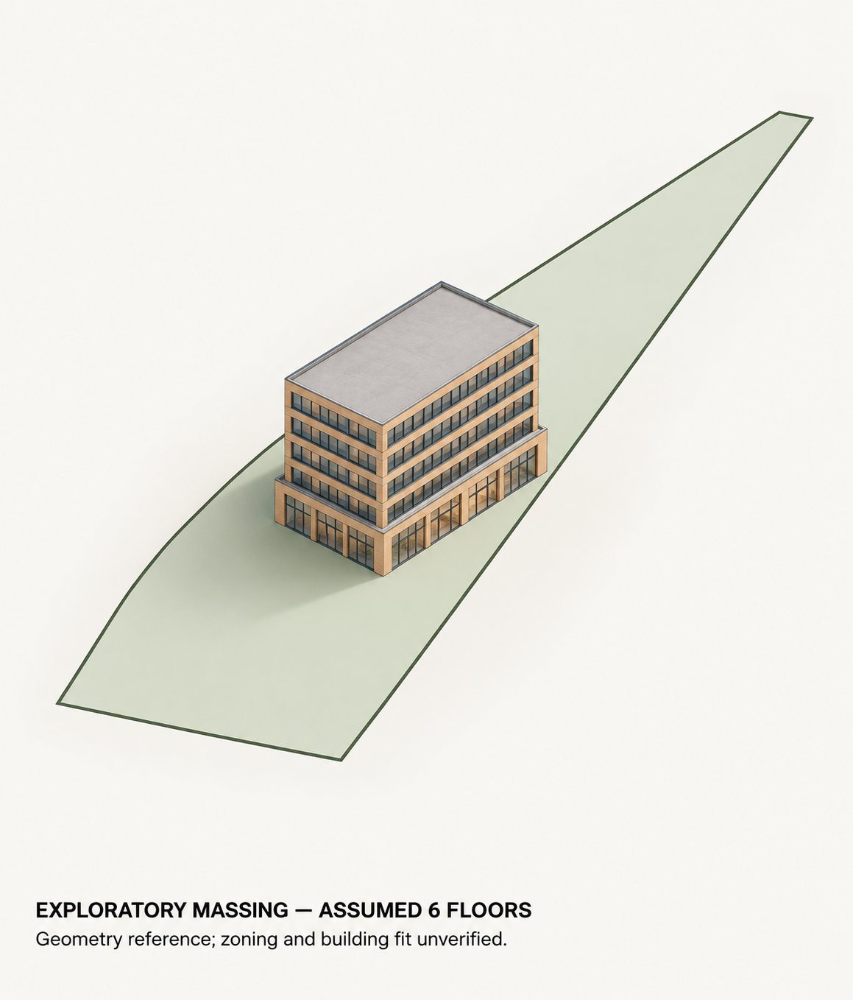

# Actual image generation from the geometry reference



This is a new, actual `image_gen.imagegen` invocation using **two local images**:
[massing reference](massing-reference.png) and [parcel plan](plan-reference.png).
Both are rasterizations of the exact SVGs in the
[verified geometry run](../grounded-massing/allocation-sensitivity/packet.md).
The original Street View photo and earlier AI concepts were not supplied.

The [exact prompt](prompt.txt) uses six floors, 64-ft assumed height, a 75×100-ft
ground plate, five 65×100-ft upper plates, 5-ft recesses and 40,000 gross-floor-proxy
sf from the explicit scenario. Buff brick, glazing and windows are additional
illustrative design choices. The dimensions and floor-use allocation were originally
chosen algebraically to match the analysis, not derived from a legal envelope.

## What the review found

One taller glazed ground floor and five upper window bands are visible. The larger
ground plate and upper recess ledges are visible. The illustration broadly follows
the schematic camera and placement in the elongated parcel. Required caveats are
present; no neighboring buildings, street scene or prior photograph was invented.

**This is visual inspection, not a geometric accuracy test.** Exact width, depth,
height, setback distance, projected scale and parcel vertices have not been measured
or registered. The image model redraws the references and may drift in proportion.
It received raster views, not the OBJ mesh or enforceable geometric constraints.
No image-generation fidelity pass, professional review, survey, legal envelope,
physical feasibility or financial feasibility is established.

## Provenance and reproduction

- `brief.json`: source-run file hashes, reference image hashes, prompt hash,
  rasterizer version and additional design assumptions.
- `invocation.json`: actual provider, local reference delivery, parameters, prompt
  binding and saved output hash. Agent-recorded, not provider-signed attestation.
- `review.json`: assistant visual inspection; metric checks remain unverified.
- `manifest.json`: inventory of this experiment, including exact saved assets.

```sh
python examples/geometry-render/verify.py
```

The verifier checks the complete original geometry run, source-to-brief bindings,
reference and prompt hashes, invocation/output binding and the experiment inventory.
It does not certify the image's interpretation or geometry. Saved outputs are
reproducible as files; another stochastic invocation need not produce identical pixels.

References were rasterized with CairoSVG 2.8.2:

```python
import cairosvg
cairosvg.svg2png(url="examples/grounded-massing/allocation-sensitivity/massing.svg", write_to="massing-reference.png")
cairosvg.svg2png(url="examples/grounded-massing/allocation-sensitivity/plan.svg", write_to="plan-reference.png")
```

CairoSVG is an optional preparation tool, not a dependency of the geometry engine.
The initial ImageMagick conversion failed because its rsvg-convert delegate was
missing; no invalid image was supplied to the provider. Source SVGs were preserved.

This is a recorded bridge experiment orchestrated by an agent. It does **not** add
mesh support to the existing photo-concept renderer or constitute a general
geometry-to-image automation API. The original geometry handoff's
`generation_executed: false` describes its earlier preparation stage; this subsequent
invocation receipt records execution. The original packet remains unchanged.

These new illustrations use project-generated geometry references, not Google
imagery. No rights to upstream parcel data are implied; see the original source
receipts and project data-license boundaries.
