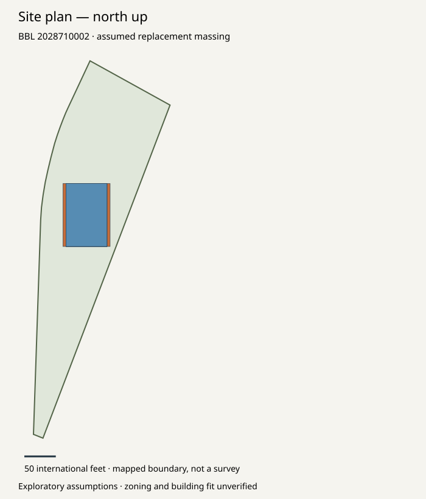
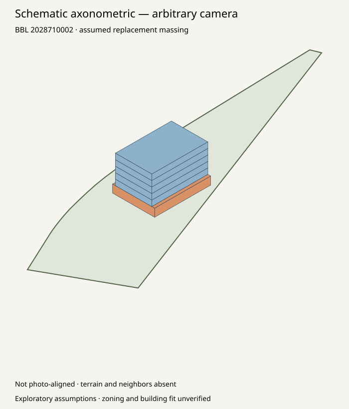

# Real parcel → explicit assumed massing → area reconciliation

[Specification](../../docs/specs/geometry-grounding.md) ·
[Module guide](../../housing_geometry/README.md)

Same sourced Bronx parcel and same verified analysis in both runs. Neither run
changes the original analysis, uses the source photograph, or generates an AI image.

| Example | Gross proxy | Nonresidential proxy | Residential proxy | Visual handoff |
| --- | --- | --- | --- | --- |
| [All nonresidential ground floor](allocation-mismatch/packet.md) | 40,000 sf | 7,500 sf | 32,500 sf | Blocked: allocation mismatch |
| [Mixed-ground allocation sensitivity](allocation-sensitivity/packet.md) | 40,000 sf | 6,000 sf | 34,000 sf | Schematic reference only |
| Original analysis targets | 40,000 sf | 6,000 sf | 34,000 sf | Professional review pending |

The assumed shape is one 75×100-ft ground plate and five 65×100-ft upper plates,
64 ft total height. Upper floors are recessed 5 ft from two sides. These are
exploratory dimensions and placement choices, not interpreted zoning constraints.
Both the shape and alternate allocation were selected algebraically to match the
existing model. A numerical match is not independent validation or a working design.





Inspect `geometry.json`, `floor-schedule.csv`, `massing.obj`, `scenario.json` and
`visual-handoff.json` in each run. Open `packet.html` locally for side-by-side views.
Original source evidence, queries and hashes remain in `parcel-source/`; the complete
verified original analysis remains in `analysis-run/`. Mapped parcel area differs
from recorded lot area, and the packet retains that discrepancy.

```sh
python -m pip install -r requirements-geometry.txt
python -m housing_geometry verify --run examples/grounded-massing/allocation-mismatch
python -m housing_geometry verify --run examples/grounded-massing/allocation-sensitivity
```

No survey, legal envelope, existing surroundings, photo camera, layouts, structural
fit, financing or professional acceptance is established. The current photo renderer
cannot consume this handoff yet. A diagnostic view remains available even when the
positive handoff is blocked.

A subsequent [actual image-generation experiment](../geometry-render/README.md) used rasterized views of the allocation-sensitivity run, with saved prompt, output and a limited visual review. The original geometry packets remain unchanged.

A [street-scene photomontage](../street-placement/README.md) subsequently used that building render and the user's reattached photograph. Approximate placement, cropping and context redraws remain explicit limitations.
