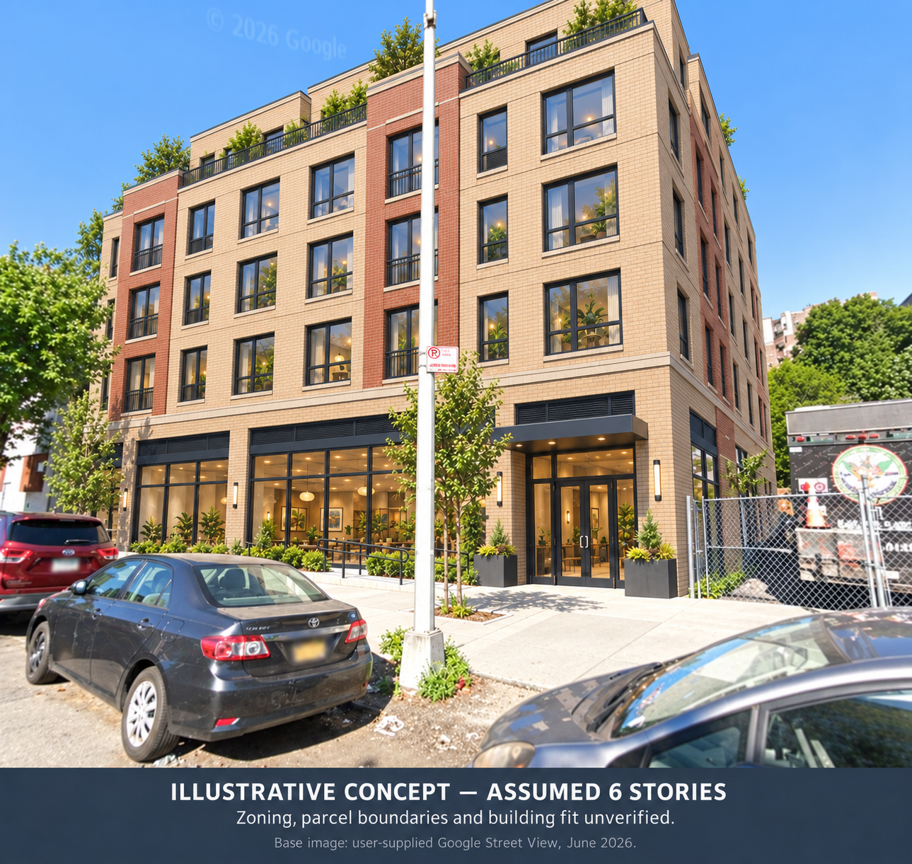

# Photo-referenced site concept

Tax lot 2028710002. Scenario: six-story-photo-concept.

The reference image anchors the visual setting. Story count, program and design are explicit assumptions/preferences. No measured building model is supplied.

## Scenario inputs

- **architectural_treatment**: Contemporary Bronx infill character: warm buff brick with restrained terracotta accents, regular generous windows, an identifiable residential entrance, glazed ground-floor frontage, modest planted upper-floor setback, and durable detailing. Daylight should match the source photograph. (design_preference). Author-selected visual treatment for discussion, not an agency or community-approved design.
- **ground_floor_use**: flexible commercial/community space (assumption). Proposed visual program only; no tenant, service provider or retention commitment is established.
- **total_stories**: 6 (assumption). Illustrative design choice, not inferred from PLUTO FAR or the earlier area-budget model.
- **upper_floor_use**: residential use (assumption). Hypothetical housing program; unit count, mix, affordability and layouts are not established.

## Site reference

Base image: user-supplied Google Street View, June 2026. Google attribution remains with the visual. Source image rights are not relicensed by the toolkit.

Reference storage: conversation_attachment. Source bytes hash: None.
An external conversation reference has no local source-byte hash; source-image reproduction needs that attachment.

## Optional analysis context

Analysis supplied: True. Analysis SHA256: 003094637d7eae88f99409db48c0b29bf203177b8152fd59a98fc8b15a2f8499.
**Area-budget reconciliation: not performed.** The assumed building is not scaled to any earlier home-equivalent calculation.

- pluto.0.address: 1240 EDWARD L GRANT HWY (source value); source pointers and hashes retained in render-brief.json and inputs/analysis.json.
- pluto.0.lotarea: 59050 (square feet as recorded); source pointers and hashes retained in render-brief.json and inputs/analysis.json.
- pluto.0.unitsres: 0 (units as recorded; source definition applies); source pointers and hashes retained in render-brief.json and inputs/analysis.json.
- pluto.0.zonedist1: R9A (source value); source pointers and hashes retained in render-brief.json and inputs/analysis.json.
- pluto.0.spdist1: J (source value); source pointers and hashes retained in render-brief.json and inputs/analysis.json.

## Unverified

- photo-to-parcel match unless separately attested
- surveyed footprint
- height in feet
- setbacks
- total floor area
- building fit
- zoning entitlement
- current occupancy
- finance

## Provider-independent prompt

Use the user-supplied original street photograph as the visual reference for an architectural concept edit. If several recent conversation images are supplied, identify the ORIGINAL white-and-blue single-story commercial building photograph; prior generated concepts are not evidence of existing conditions. The user associates this reference with NYC tax lot 2028710002; that match is user_asserted, not independently geolocated by this module. Viewpoint instructions: Use the original street-level view showing the white-and-blue single-story commercial structure. Preserve the street slope, parked cars, center pole, trees, adjacent structures and fence as closely as possible. Camera pose and parcel boundaries are not measured. Illustrate a hypothetical replacement building with exactly 6 stories TOTAL: one taller ground floor for flexible commercial/community space, and 5 upper floors for residential use. Architectural treatment: Contemporary Bronx infill character: warm buff brick with restrained terracotta accents, regular generous windows, an identifiable residential entrance, glazed ground-floor frontage, modest planted upper-floor setback, and durable detailing. Daylight should match the source photograph. Use approximately the visible existing building location as a visual cue only. No surveyed footprint, parcel boundary, setback distance or total floor area has been supplied. Preserve the photographed street perspective and surrounding context as closely as possible. Do not redesign neighboring properties. This is a replacement concept; do not imply that extra floors can be supported by the existing structure. Do not invent street numbers, tenant names, approved unit counts, affordability commitments or official approval. Remove large navigation UI controls while retaining source watermark/attribution. Include a readable bottom caption with these lines: "ILLUSTRATIVE CONCEPT — ASSUMED 6 STORIES" and "Zoning, parcel boundaries and building fit unverified." Credit: "Base image: user-supplied Google Street View, June 2026." A separate area-budget analysis, if present in the packet, is context only and has not been reconciled to this massing. Generate a photorealistic illustrative streetscape, not an assertion of feasible or approved development.

## Generated illustration

## Visual review

The generated asset follows the compiled illustrative brief in broad architectural treatment and visible street context. It has no visible invented street number or tenant sign. This inspection does not establish source-pixel fidelity, an exact story count, geometry, site identity or feasibility. Multiple recent conversation images, including prior concepts, were available to the provider; original-only conditioning is not independently auditable.

- **reference_setting — consistent_by_inspection**: Approximate parked-car arrangement, central pole, trees, adjacent fence and camera view resemble the supplied setting; they are generatively redrawn, not measured or pixel-locked.
- **story_count — not_verified**: Visible levels broadly suggest the requested scale, but the recessed upper portion is partly cropped. The six-story caption is an instruction label, not a verified floor count.
- **caption — consistent_by_inspection**: Caption labels an assumed six-story illustrative concept and states that zoning, boundaries and fit are unverified; Google attribution and source credit are visible.
- **invented_site_details — consistent_by_inspection**: No new street number, named tenant, unit count or approval claim is visible. The architecture, planting and detailed facade remain invented design features.
- **geometry_fidelity — not_verified**: No surveyed footprint, height, setbacks, area allocation, geolocated camera or matching parcel polygon was supplied.

Review is an attested visual inspection, not independent professional acceptance.
