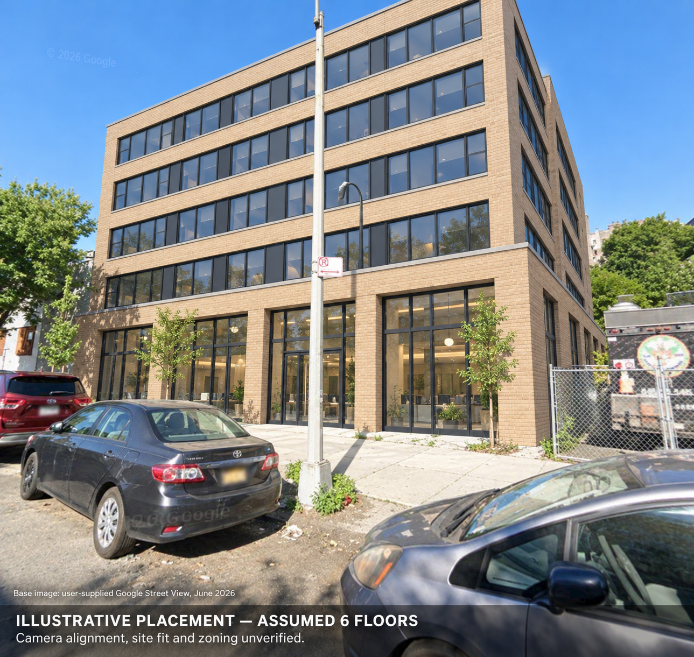

# Geometry-derived design placed into the user's street photograph



Actual `image_gen.imagegen` output using the reattached user-provided Google Street
View screenshot and the [new geometry-reference building render](../geometry-render/README.md).
The latter was shown to the image tool immediately before generation; the invocation
used the two most recent images. The original screenshot remains an external
conversation attachment, with no local byte hash and no redistribution here.

This closes a **visual** chain: real parcel evidence → explicit assumed massing →
geometry-reference illustration → street-scene photomontage. It does not close
camera registration, measured site placement or geometric fidelity.

## What changed in this step

The proposed replacement building is depicted approximately where the photographed
white-and-blue commercial building stands. This placement is a new assumption. The
original geometry scenario placed its footprint near the mapped parcel centroid;
no mapping establishes that the photographed facade location equals that placement.
The image tool was instructed to preserve six total floors, the larger ground plate,
upper recesses, buff brick and dark windows while adopting the photograph's viewpoint.
The model dimensions remain design intent; the photo does not measure them.

## Review: useful illustration, with observed issues

- The brick/glazing design and taller ground floor are recognizable.
- Roof and part of the upper building are cropped. Complete floor-count and total
  height confirmation are not established by the caption.
- Some street context is redrawn: cars and details differ, and new planting appears.
  This is not a pixel-preserving composite.
- Exact recess distances, footprint, placement, scale, boundary containment and
  camera alignment are unverified. No measured image-to-mesh comparison occurred.
- Caveat caption and Google source credit are visible. Zoning and building fit
  remain unverified; no professional review or approval is implied.

The first result is retained with its issues; it is not labeled a fidelity pass.
A later iteration should use a calibrated camera and controlled silhouette/masks,
then inspect against geometry rather than the attractiveness of the picture.

## Evidence and checks

`prompt.txt` is the exact tool prompt. `invocation.json` records the actual image
selector, design-source hashes, external photo limitation, placement assumption and
output hash. `review.json` records assistant visual inspection. `manifest.json`
binds this experiment's saved files. These are agent-recorded receipts, not
provider-signed attestation or proof of semantic correctness.

```sh
python examples/street-placement/verify.py
```

This remains an agent-orchestrated experiment, not a general photo-registration
adapter. No original geometry or earlier generated artifact was overwritten.
Photo-based generated imagery remains excluded from the project's blanket code
and documentation licenses; upstream Google attribution and source terms apply.
