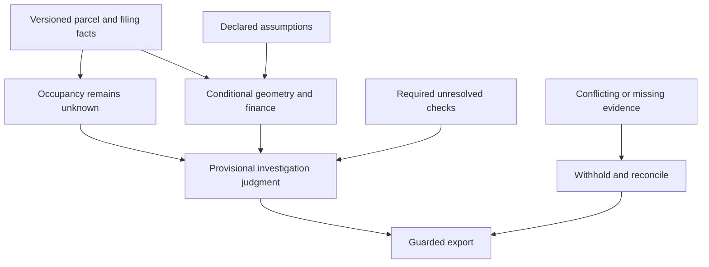

# One site conclusion tested end to end

7 October 2026. The technical foundation now carries one provisional site conclusion from exact source values through illustrative calculations, assumptions, authored judgment and release checks. Source revision, contradictory evidence and missing requirements are tested on that same chain. Independent reproduction and substantive challenge by an unfamiliar human remain pending.

## The conclusion

For **1240 Edward L Grant Highway**, investigate current uses and leases before committing to a housing design. This is an authored research priority based on the October 3 cached snapshot. It is not a current occupancy determination or a finding that the site is worth acquisition.

PLUTO records zero residential units, 59,050 sf of lot area and version 26v2. Historical DOB filing passages describe laundromat construction, a school-to-hall filing and a medical awning. They identify reasons to investigate use; none establishes who occupies the site today. An E-designation records environmental obligations whose satisfaction is unknown. The site is approximately 434 metres straight line from the published 170 St station coordinate; usable pedestrian and job access remain unverified.

Conditional concept A produces 271 illustrative homes and approximately 288,636 gross sf under declared area and unit-size assumptions. The financing model is a debt-support illustration. It excludes land, relocation, remediation, demolition, financing carry and equity return. Recorded FAR is a reference input, not verified legal or physical capacity.

## Precommitted perturbations

The fixed-site scope, eight unresolved checks and eleven cases were committed before implementation and outcomes. The author already knew the baseline site and calculations. These are known engineering controls, not an independent benchmark.

| Change | Observed response |
| --- | --- |
| Keep original inputs | Occupancy-first investigation remains the provisional conclusion; all professional checks stay unresolved. |
| Raise assumed hard cost from $350 to $525 per gross sf | Debt-support rent rises from approximately $3,869 to $5,804 per unit/month. Illustrative unit count stays unchanged. |
| Lower assumed hard cost to $140 per gross sf | Debt-support rent falls to approximately $1,548; the modeled additional capital gap closes at hypothetical $1,800 monthly rent. Occupancy remains unknown and design clearance stays blocked. |
| Reduce recorded lot area by 20 percent in a synthetic copied source | Area, units and finance recompute. The old judgment basis becomes stale, even though the investigation priority remains provisional. |
| Change recorded units from zero to 48 in a synthetic copied source | The disposition changes to reassess resident impacts before design. This is a response test, not a new site finding. |
| Introduce incompatible units under the same declared dataset version | The conclusion is withheld for source reconciliation. Affected dependent claims are flagged; no winner is chosen. |
| Introduce units from a different declared version | The conclusion is withheld for temporal reconciliation. A later-looking record cannot silently overwrite the earlier context. |
| Delete occupancy or finance requirements | Both omissions are rejected against the pinned authored inventory. |
| Remove a material historical passage | The conclusion is withheld for missing evidence; missing text does not clear occupancy. |
| Change cached bytes without a matching receipt | Source integrity fails before a conclusion is released. |

All eleven case responses match the precommitted expectations. All **20 behavioral tests** pass. Whole-experiment replay is byte-identical. There are four supporting source families and 73 connected claims; those counts are implementation scope, not a quality score.

## The reasoning boundary

Every material fact in the generated conclusion resolves to an exact cached row/field and receipt. Every displayed calculation comes from the same graph. Assumptions resolve to the embedded editable configuration. Authored judgment is attributed and awaits independent professional acceptance. All eight site checks remain unknown. The original site screen and retrospective assessments are preserved.

The contradiction checker needs assertions already linked to the same parcel and supported field. It does not discover or interpret arbitrary contradictions in prose. Requirement removal is detected against a curated baseline; an unrecognized requirement can still be missing. Source locations and reproducibility do not establish semantic entailment, complete analysis or professional judgment.

## The remaining test

The package includes source bodies, receipts, calculations, all variants, hashes, a reproduction protocol and a pending review form. An unfamiliar reviewer should first assess the conclusion, then trace three claims, reproduce the run, change an assumption and challenge the interpretation or identify an omitted decisive constraint. A well-supported rejection is useful feedback.

Technical replay by the author is complete. Independent human challenge, practitioner usefulness, site-selection quality and current feasibility remain open. The next product question is whether this occupancy-first task is the right use of a practitioner's time, compared with title, environmental review or another investigation.
