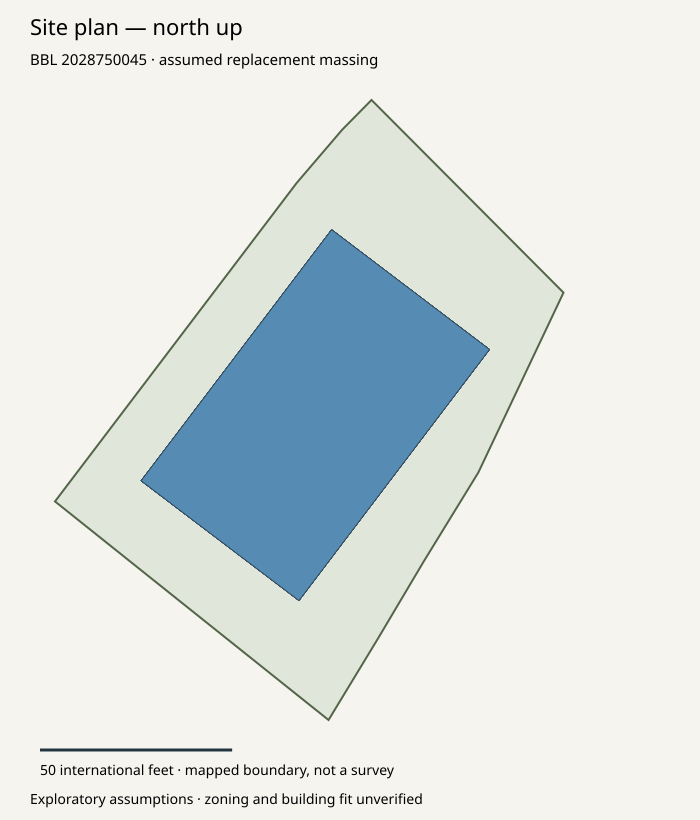
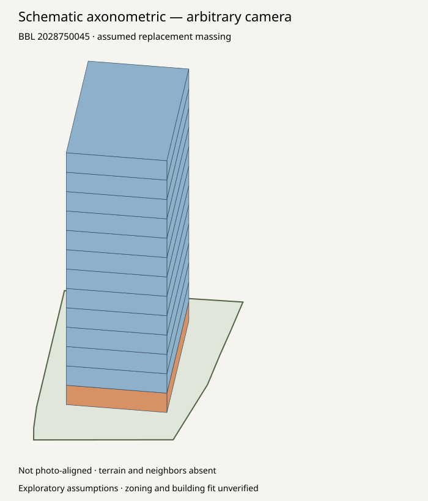

# Grounded exploratory massing: 2028750045

**schematic_reference_only**. Design assumptions, not a zoning envelope or professionally validated design.

## Geometry and analysis agreement

| Quantity | Geometry proxy sf | Analysis sf | Difference sf | Status |
| --- | --- | --- | --- | --- |
| gross | 54901.97 | 54901.97 | 0.00 | consistent_within_tolerance |
| nonresidential | 5490.20 | 5490.20 | 0.00 | consistent_within_tolerance |
| residential | 49411.77 | 49411.77 | 0.00 | consistent_within_tolerance |

## Source and assumptions

Mapped source: NYC DCP MapPLUTO 26v2. BBL matches the verified analysis. Original bytes, exact query, metadata and retrieval receipts are in parcel-source/.

Mapped polygon area: 10700.33 sf. Source recorded lot area: 9750.00 sf. Difference: 950.33 sf; unreconciled observations, not a correction.

Assumed floor count: 13. Assumed total height: 156 international feet. Coordinates and rationales are in scenario.json. No height or footprint was inferred from the source photo.

The 40,000-sf example dimensions were selected to match the area budget algebraically. A match is a consistency test, not independent validation. Gross polygon area and fractional use allocation are simplified proxies, not code-compliant measured areas or architectural layouts.

All review gates remain unknown: zoning, survey, access_egress_layout, structural_geotechnical, finance, existing_context, photo_camera, professional_review.

## Inspect the outputs

[Floor schedule](floor-schedule.csv) · [Geometry IR](geometry.json) · [Mesh](massing.obj) · [Visual handoff](visual-handoff.json)

analysis-run/ retains the complete original verified analysis. This geometry module has not changed its assumptions, calculated homes or review gates. No photorealistic image was generated.
